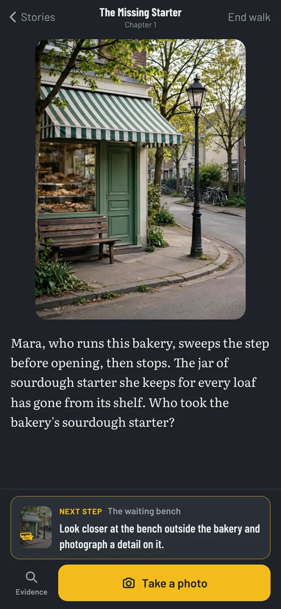
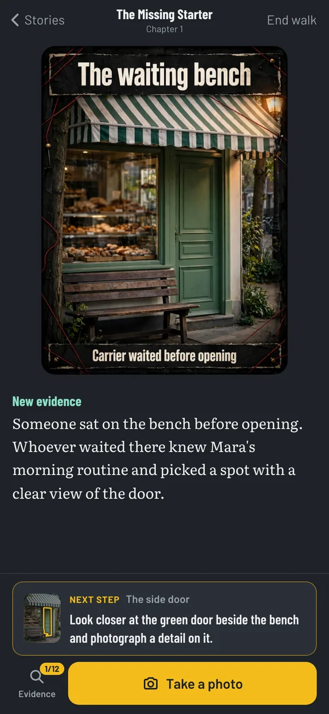
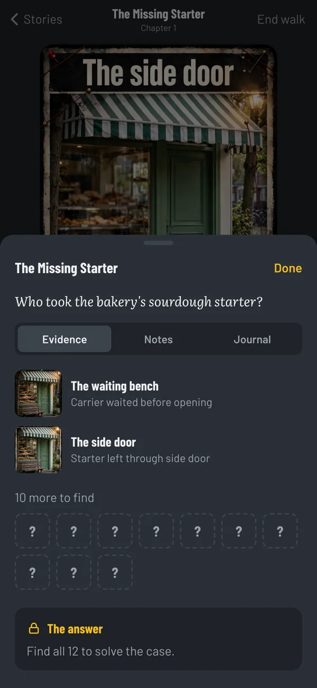

<div align="center">

# Questory

**Turn photos of your street into a story.**

Wren, an AI game master, builds a case from what you photograph.

Play at [questory.run](https://questory.run)

<p>
  
  
  
</p>

</div>

Questory is made for phones. Open [questory.run](https://questory.run) on your phone, or scan the code it shows on a computer. It was built on the Meta Model API for the Meta Global AI Developer Hackathon.

## How to play

1. Pick a theme for the story.
2. Take a photo of where you are. Wren writes the opening of the case around it, then leads you outside if you aren't already.
3. Follow the quests to find evidence. A quest asks for a closer look at something in your last photo, or sends you a block or two away to find something.
4. Collect evidence until it points to the answer. A case has multiple chapters. You can stop at any time, and your next photo picks the story up wherever you are.

To play with a friend, choose "With a friend" and send them the link. You each follow your own lead on your own walk, at the same time or not, and a chapter ends once you have both finished your part.

## How it works

Questory is a Next.js 16 app that uses four models from the Meta Model API:

| Model | Used for |
| :--- | :--- |
| Muse Wonder | Playing Wren: reading each photo and writing the story and quests |
| Muse Spark | Checking Wren's lines against the photo |
| SAM 3.1 | Outlining what a closer-look quest points at |
| Muse Image | Redrawing photos that turn up evidence as evidence cards |

### A turn

1. You take a photo. The phone resizes it to 1280 px, re-encodes it as JPEG and uploads it.
2. Muse Wonder reads the photo with the story so far. In one structured JSON reply, it decides what the photo means, writes a few lines and gives the next quest if there is one. A photo can answer the current quest, take the story somewhere new, or be a side note that leaves the quest open.
3. Unless the photo was a side note, Muse Spark compares Wren's lines with the photo and removes anything described as visible that isn't there. At the same time, if the next quest is a closer look, SAM finds its target in the photo and outlines it, so you know where to look.
4. If the photo turned up evidence, Muse Image paints an evidence card from it.

### The case

Every case has one question and a hidden answer that Wren decides at the start. Wren plans each chapter as places and objects to find, and each quest goes where the last find pointed, so the evidence forms a trail.

Each photo becomes something it could reasonably be in the story. After two side notes in a row, the next photo moves the story whatever it shows. If the evidence stops pointing to the answer, Wren changes the answer to fit everything found so far.

### Story memory

Wren keeps each story in three layers, saved after every turn:

| Layer | What it holds | How it changes |
| :--- | :--- | :--- |
| Skeleton | The hidden plan: the answer, what each chapter finds out, and the steps on each lead | Only when your photos call for it |
| Bindings | Which real thing is which story element | Freely, on any turn |
| Canon | Facts already established in play | Never contradicted |

### Two players

A shared case has two leads that come at the answer from different sides, such as how it was done and who could have done it. Each player follows one lead without waiting for the other. Wren sees what both have found and mentions a partner's find when it changes what yours means. A chapter's ending is written from everything both players found. Turns are saved under a short per-story lock, so two photos sent at once both count. If your friend hasn't joined by the time your part is done, you can play their lead too.

## Privacy

- There is no account. A random ID in a cookie links your stories to your browser.
- The app never asks for your location. Photos are re-encoded on the phone before upload, which removes their location data, and walk times come from when photos were sent.
- Photos go to the Meta Model API and are then stored in an encrypted private bucket, served only through unguessable links.
- An invite link shows only its own case, and a case has room for one friend, so a forwarded link can't let a third person in.
- Deleting a story also deletes its photos and evidence cards.

## Run it locally

You need Node.js 20.17 or later.

```sh
npm install
cp .env.example .env.local   # add MODEL_API_KEY to use the real models
npm run dev
```

Open http://localhost:3000. Without `MODEL_API_KEY`, the app uses a scripted game master, so you can work on the interface without spending credit. Without the Appwrite settings, it saves stories as files in `.data/`. `GET /api/health` shows which mode, models and storage are in use. The other settings, such as the daily call limits, are documented in [`.env.example`](.env.example).

To try it on a phone on the same Wi-Fi, open the Network address that `npm run dev` prints and scan the code it shows. Anyone on that network can reach the server, so stop it when you're done if a real key is set.

Run the unit tests with `npm test`.

## Deployment

The live game at questory.run runs on Vercel, and every merge to `main` deploys it. Stories, photos and evidence cards are stored in Appwrite, in a database and a private bucket that `npm run setup:appwrite` creates.

A photo turn costs about 3 to 5 cents, plus 1 cent when Muse Image paints an evidence card. Daily call limits cap what a day can cost.

## Project structure

```
app/page.tsx   Landing page, with a code to scan on a computer
app/play/      The game
app/api/       Route handlers for stories, turns, evidence cards, media and health
components/    The mobile interface
lib/gm/        The game master: state, prompts, output schemas, engine and a scripted mock
lib/meta/      Meta Model API clients for structured JSON, SAM 3.1 and Muse Image
lib/store/     Storage in local files or Appwrite
lib/client/    Browser code for photos, API calls and invite links
scripts/       Appwrite setup
```

## License

Questory is released under the [MIT License](LICENSE). The Barlow and Literata fonts are under the SIL Open Font License (see `app/fonts/`).
